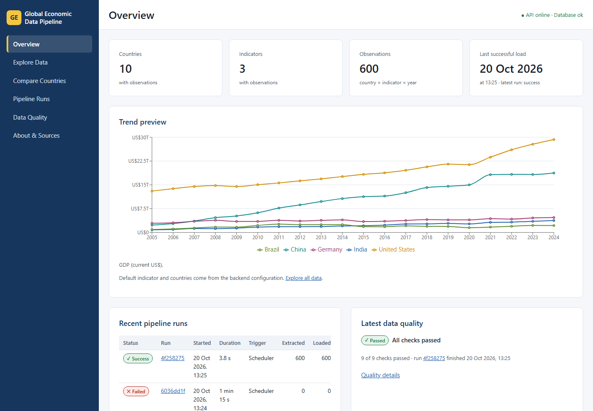
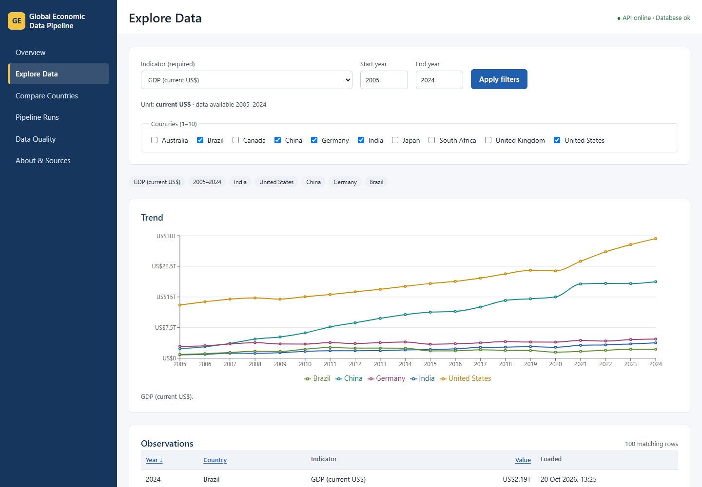
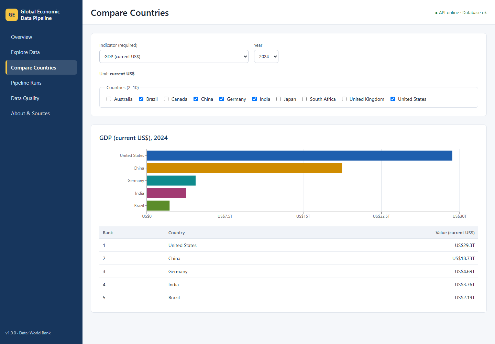
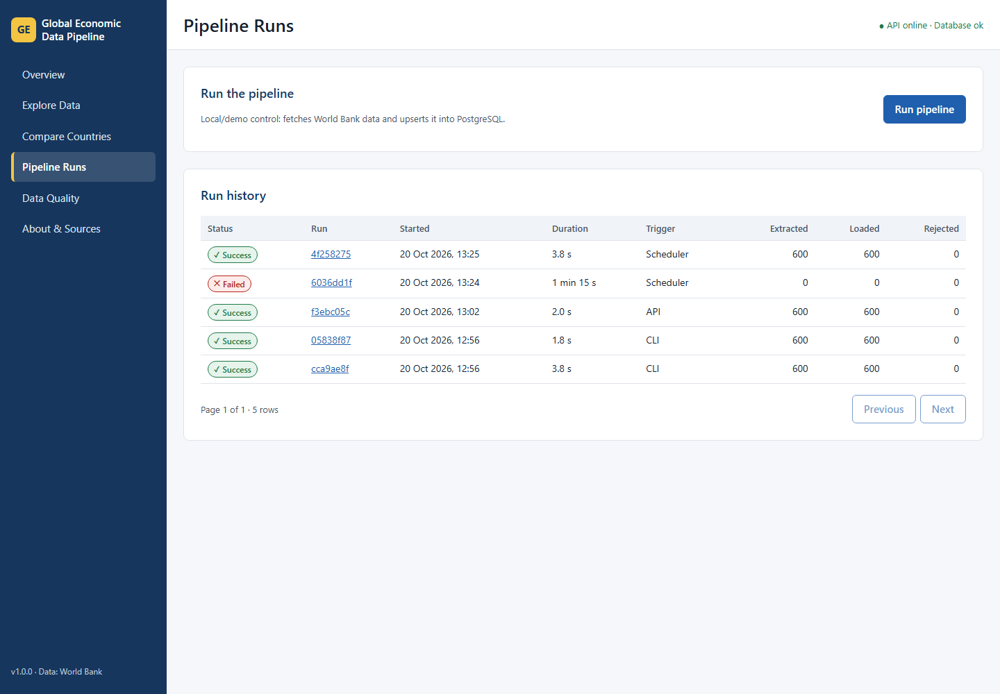
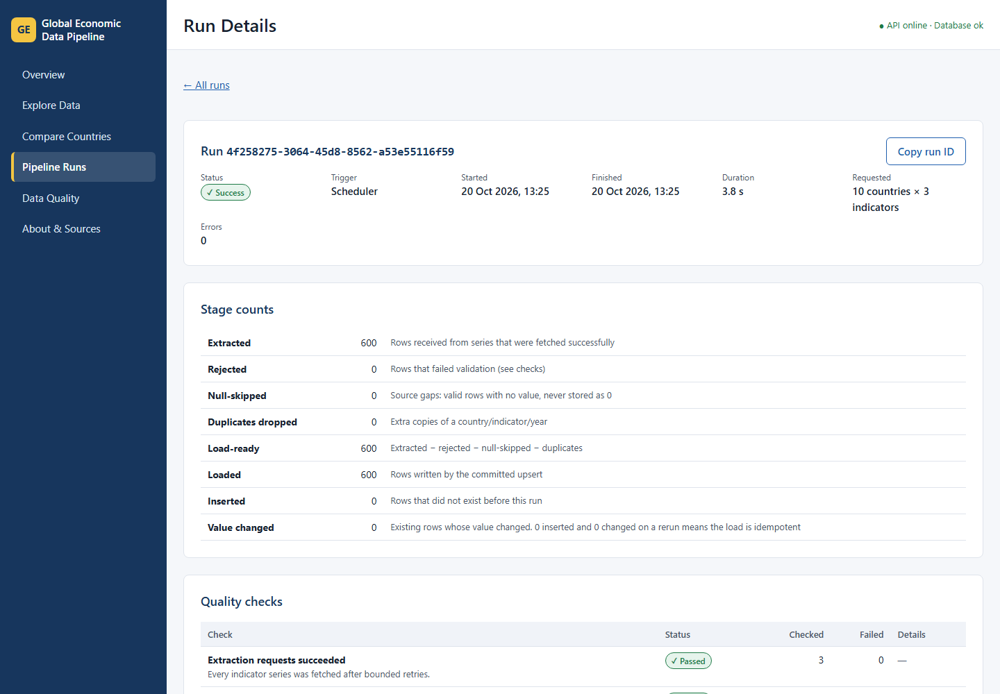
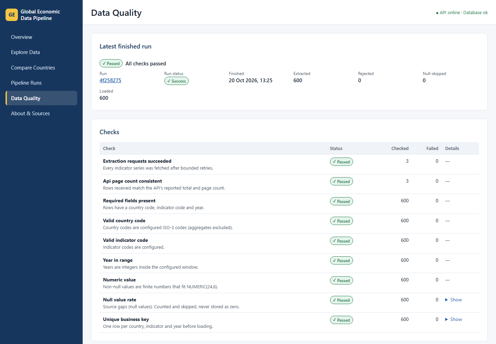
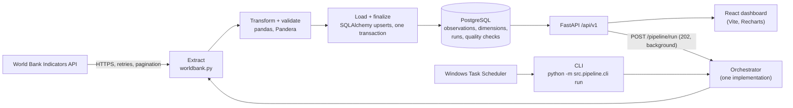

# Global Economic Data Pipeline & Analytics Dashboard

A data-engineering portfolio project that collects economic indicators from the [World Bank Indicators API](https://datahelpdesk.worldbank.org/knowledgebase/topics/125589-developer-information), validates them with pandas and Pandera, loads them **idempotently** into PostgreSQL, records every run and its data-quality results, and serves them through a FastAPI backend and a React dashboard.

> **Status:** MVP complete (implementation-plan phases 0–11). Runs locally on Windows; it has not been deployed publicly. The manual run endpoint is for local/demo use only.



## What it demonstrates

- **Reliable extraction:** timeouts, bounded exponential backoff (honoring `Retry-After`), full pagination with consistency checks, and explicit detection of World Bank error payloads that arrive with **HTTP 200**. An API failure is never mistaken for an empty dataset.
- **Validation with reasons:** a Pandera schema rejects invalid rows with a recorded reason; null source values are counted and skipped, **never stored or shown as zero**; duplicates are removed before loading.
- **Idempotent loads:** PostgreSQL upserts on `(country_code, indicator_code, year)`. Rerunning on unchanged data reports `inserted=0 value_changed=0`.
- **Auditable runs:** every run is recorded before work starts and ends in exactly one status (`success`, `partial_success`, `failed`). A partial unique index allows only one running run in the whole database, and crashed runs are recovered as failed.
- **Honest UI:** loading, empty and error states; gaps instead of zeros; a quality view that is never green for a failed run.

## Screenshots

All screenshots show the working application with real World Bank data loaded into the local database (captured 2026-10-20).

| | |
|---|---|
|  |  |
| Explore Data: filters, trend and paginated table | Compare Countries: sorted bars plus table |
|  |  |
| Run history, including a real failed (abandoned) run | Run detail: an idempotent rerun with 0 inserted, 0 changed |



## Architecture



- **One pipeline, three entry points.** The CLI, the dashboard's Run button (API background task) and Task Scheduler all call the same orchestrator.
- **Run lifecycle (D-18):**
  1. A `running` row is committed on its own (claim).
  2. Extraction and validation happen in memory.
  3. Observations, quality checks and the final status are committed together in one transaction.
  4. If loading fails, everything in that transaction rolls back and the run is recorded as `failed` in a separate transaction, so the audit record always survives.
- **The browser never touches the database.** The React app calls FastAPI only; in development Vite proxies `/api` and `/health` to the backend.

Design decisions and their rationale are in [docs/DECISIONS.md](docs/DECISIONS.md) (`D-xx`).

## Tech stack

| Layer | Technology (versions verified in this repository) |
|---|---|
| Runtime | Python 3.12.10, Node.js 24 LTS |
| Extraction | requests 2.34 |
| Transform / validation | pandas 3.0, NumPy 2.5, Pandera 0.34 |
| Database | PostgreSQL 17, SQLAlchemy 2.1, psycopg 3.3, Alembic 1.20 |
| API | FastAPI 0.150, Pydantic 2.14, pydantic-settings 2.16, uvicorn 0.54 |
| Frontend | React 19, TypeScript 7, Vite 8, Recharts 3, React Router 7 |
| Tests | pytest 9, pytest-cov, responses, httpx2 (TestClient), Vitest 5, Testing Library |
| CI | GitHub Actions with a PostgreSQL 17 service container |
| Scheduling | Windows Task Scheduler running the CLI |

Exact pins: `backend/requirements.txt`, `backend/requirements-dev.txt`, `frontend/package-lock.json`.

## Database design

| Table | Purpose | Key rules |
|---|---|---|
| `countries` | ISO-3 country metadata | `CHECK` ISO-3 format; aggregates excluded by configuration |
| `indicators` | Indicator metadata | unit is required and comes from configuration |
| `economic_observations` | One value per country, indicator and year | composite primary key; `value NOT NULL` (nulls are skipped, never 0); foreign keys |
| `pipeline_runs` | One row per run attempt | status and trigger CHECKs; `finished_at` set iff terminal; count bounds; **partial unique index: at most one `running` row** |
| `data_quality_checks` | Check results per run | status CHECK; one row per check per run |

The schema is created by Alembic migrations (`backend/alembic/versions/`). Details: [docs/Backend_DB_Schema.md](docs/Backend_DB_Schema.md).

## Repository layout

```text
global-economic-data-pipeline/
├── backend/
│   ├── alembic/                  # migrations (URL read from settings, never stored)
│   ├── src/
│   │   ├── api/                  # FastAPI routers, schemas, errors, dependencies
│   │   ├── core/                 # settings (pydantic-settings), logging
│   │   ├── db/                   # models, sessions, upsert repositories
│   │   ├── pipeline/             # worldbank client, transform, quality, runs, orchestrator, CLI
│   │   ├── services/             # read queries for the API
│   │   └── main.py               # FastAPI app
│   ├── tests/                    # unit/ (no database) and integration/ (gedp_test)
│   ├── .env.example
│   ├── requirements.txt / requirements-dev.txt
│   └── pytest.ini
├── frontend/
│   ├── src/                      # api client, components, hooks, pages (+ *.test.tsx), utils
│   ├── package.json / package-lock.json
│   └── vite.config.ts
├── scripts/                      # run_pipeline.ps1 (scheduled run), register_task.ps1
├── docs/                         # specifications, decisions, scheduling, dev log, screenshots, samples
└── .github/workflows/ci.yml
```

## Setup from a fresh clone (Windows, PowerShell)

**Prerequisites:** Git, Python 3.12, Node.js 24 LTS, PostgreSQL 17.

**1. Create the database role and databases.** Run once as the PostgreSQL superuser and choose your own password:

```powershell
& "C:\Program Files\PostgreSQL\17\bin\psql.exe" -U postgres
```
```sql
CREATE ROLE gedp_app LOGIN PASSWORD 'choose-a-strong-password';
CREATE DATABASE gedp_dev OWNER gedp_app;
CREATE DATABASE gedp_test OWNER gedp_app;
```

**2. Backend.** From the repository root:

```powershell
git clone https://github.com/parammeet83/global-economic-data-pipeline.git
cd global-economic-data-pipeline
python -m venv .venv                 # the project uses this single root virtual environment
.\.venv\Scripts\Activate.ps1
cd backend
pip install -r requirements-dev.txt
Copy-Item .env.example .env          # git-ignored
notepad .env                         # replace both CHANGE_ME values with your gedp_app password
python -m src.core.config            # "Configuration OK" + databases, without the password
alembic upgrade head                 # create the schema in gedp_dev
python -m src.pipeline.cli run       # load real World Bank data (about 600 rows)
uvicorn src.main:app --reload        # API on http://127.0.0.1:8000 (docs at /docs)
```

If the password contains `@ : / ? # %` or spaces, URL-encode them in `.env` (for example `@` becomes `%40`).

**3. Dashboard.** In a second terminal:

```powershell
cd frontend
npm ci
npm run dev                          # http://localhost:5173
```

## Usage

### Pipeline CLI (from `backend/`)

```powershell
python -m src.pipeline.cli run                           # one run
python -m src.pipeline.cli run --triggered-by scheduler  # recorded as a scheduled run
```

The command prints the run ID, status and counts (extracted, rejected, null-skipped, duplicates dropped, load-ready, loaded, inserted, value changed).

| Exit code | Meaning |
|---|---|
| 0 | success |
| 1 | failed |
| 2 | partial success |
| 3 | another run is already in progress |
| 4 | configuration or database startup error |

### API

| Method | Endpoint | Purpose |
|---|---|---|
| GET | `/health` | Service and database status (200 or 503) |
| GET | `/api/v1/dashboard/summary` | KPI counts, latest run, overview defaults |
| GET | `/api/v1/indicators` | Indicators with configured units and coverage |
| GET | `/api/v1/countries` | Countries present in the data |
| GET | `/api/v1/observations` | Filtered, sorted, paginated observations |
| GET | `/api/v1/analytics/trend` | Annual series per country (missing years are absent, never 0) |
| GET | `/api/v1/analytics/country-comparison` | One indicator and year across 2–10 countries, plus unavailable countries |
| GET | `/api/v1/runs`, `/api/v1/runs/{run_id}` | Run history; run detail with counts and checks (polling endpoint) |
| GET | `/api/v1/quality/latest` | Checks of the most recent finished run, including a failed one |
| POST | `/api/v1/pipeline/run` | Start a run: 202 + run ID; 409 if one is running; 403 if disabled or not from this machine |

Errors always have the form `{"error": {"code": "...", "message": "..."}}` and never include stack traces, SQL or credentials. The interactive OpenAPI documentation is at `http://127.0.0.1:8000/docs`.

### Dashboard pages

- **Overview:** KPIs, latest run status and a trend preview.
- **Explore Data:** filters, trend chart and an observation table.
- **Compare Countries:** one indicator and year across 2–10 countries.
- **Pipeline Runs:** history, run detail and the Run button (with a confirmation dialog and live polling).
- **Data Quality:** results of the most recent finished run.
- **About & Sources:** the data source, indicators and limitations.

### Scheduling

`scripts/run_pipeline.ps1` runs the CLI as a scheduled run and logs to `logs/` (git-ignored). `scripts/register_task.ps1` creates a daily Windows Task Scheduler task; review it before running. Full guide: [docs/SCHEDULING.md](docs/SCHEDULING.md).

## Tests

```powershell
# backend/ (venv active). Integration tests use only TEST_DATABASE_URL (gedp_test); each test is rolled back.
pytest                       # all tests (the optional live World Bank test is excluded)
pytest tests/unit            # no database needed
pytest -m integration        # PostgreSQL tests
pytest -m live               # optional: one small request to the real World Bank API
pytest --cov=src             # coverage

# frontend/
npm test                     # Vitest + React Testing Library
npm run build                # type check + production build
```

**Results** (measured 2026-10-20 on Windows, Python 3.12.10, PostgreSQL 17.11):

- Backend: **157 passed** (unit and integration), **97% line coverage**.
  - The World Bank API is mocked in every automated test.
  - The optional live test passed separately.
  - A fresh clone from GitHub also passed `alembic check` and the suite once a CI-only environment issue was fixed (commit `de53453`).
- Frontend: **26 passed** in 7 files, and the production build has no warnings.

**Covered by the tests:**
- **Extraction:** retries and backoff, pagination consistency, HTTP-200 error payloads and the valid empty result.
- **Rows and counts:** every validation rule, null handling, de-duplication and the count identity `E = R + N + D + T`.
- **Run lifecycle:** run statuses, load rollback with a durable run record, the overlap guard, stale-run recovery and CLI exit codes.
- **Database:** migrations (upgrade/downgrade in a throwaway schema), every constraint family and upsert idempotency.
- **API:** contracts, error shapes and CORS.
- **UI:** loading, empty and error states, never showing missing values as zero, and the trigger and polling flow.

**CI:** `.github/workflows/ci.yml` runs the backend suite against a PostgreSQL 17 service container and the frontend `npm ci`, build and tests on every push and pull request. Results are in the repository's Actions tab.

## Measured results (local, real data)

These figures come from real runs on 2026-10-20, for 10 countries × 3 indicators × 2005–2024:

| Run | Status | Extracted | Loaded | Inserted | Value changed | Pipeline time |
|---|---|---|---|---|---|---|
| First load (CLI) | success | 600 | 600 | 600 | 0 | 3.8 s |
| Rerun (CLI) | success | 600 | 600 | 0 | 0 | 1.8 s |
| Dashboard trigger (API) | success | 600 | 600 | 0 | 0 | 2.0 s |
| Scheduled-style run (wrapper script) | success | 600 | 600 | 0 | 0 | 3.8 s |

After these runs, the database held 600 observations with 600 distinct keys (no duplicates). All 9 quality checks passed. A sample report is in [docs/samples/quality-report-sample.json](docs/samples/quality-report-sample.json), the optional JSON export from a real run.

## Configuration

All settings come from environment variables or `backend/.env`; see `backend/.env.example`. The main ones:

| Setting | Default |
|---|---|
| `DATABASE_URL`, `TEST_DATABASE_URL` | none (required); `postgresql+psycopg://` URLs |
| `COUNTRY_CODES` | `IND,USA,GBR,DEU,JPN,CHN,BRA,ZAF,CAN,AUS` (ISO-3) |
| `INDICATOR_CODES` and `INDICATOR_UNITS` | GDP (current US$), population, unemployment (%) |
| `START_YEAR`, `END_YEAR` | 2005, 2024 |
| `ENABLE_MANUAL_TRIGGER` | true locally |
| `STALE_RUN_MINUTES` | 60 |
| `CORS_ORIGINS` | `http://localhost:5173` |

Startup validates every value and reports problems without echoing secrets. The full list is in [docs/TRD.md](docs/TRD.md) §9.

## Troubleshooting

| Problem | What to do |
|---|---|
| `Configuration error … DATABASE_URL: is required` | Create `backend/.env` from `.env.example`. |
| `/health` returns 503 | Check the `postgresql-x64-17` service is running and the password in `.env` is right. |
| `ModuleNotFoundError` or wrong packages | Activate the root `.venv` first (`.\.venv\Scripts\Activate.ps1`). `python -c "import sys; print(sys.executable)"` should point into `.venv`. |
| Port 8000 already in use | Another API instance is running. Stop it, or start this one with `--port 8001` and run the dashboard with `$env:VITE_BACKEND_URL="http://127.0.0.1:8001"; npm run dev`. |
| CLI exit code 3 | A run is in progress. If a run crashed, it is marked failed automatically after `STALE_RUN_MINUTES`. |
| Dashboard shows "Cannot reach the backend" | Start the API (`uvicorn src.main:app --reload` in `backend/`). |
| Dashboard is empty | Run `python -m src.pipeline.cli run` once. |

## Security notes

- `backend/.env` is git-ignored and `.env.example` contains placeholders only. Database URLs are stored as masked secrets in settings, and validation errors never echo values.
- API errors, run summaries and logs contain no stack traces, SQL, driver messages or credentials.
- The manual run endpoint has no authentication. It is disabled by `ENABLE_MANUAL_TRIGGER=false`, accepts loopback clients only (D-38), and must not be exposed publicly without authentication and rate limiting.
- The database user `gedp_app` is not a superuser; tests use a separate `*_test` database and never truncate or drop data (D-37).

## Known limitations

- **Single-process runs.** Runs started from the dashboard execute inside the API process. Restarting the API (including `--reload` after a code change) abandons the run, which is recorded as failed by stale-run recovery after `STALE_RUN_MINUTES`.
- **Data shape.** Data is annual. Coverage varies by country, indicator and year, and figures may be revised by the World Bank after they are loaded.
- **Scope.** Three indicators and ten countries by default. Aggregates (World, regions) are excluded on purpose.
- **Not production.** Local/demo deployment only. There are no user accounts or authentication.
- **CI.** CI runs on Linux (Ubuntu). Local development and every test result above are from Windows.

## Deferred (optional) enhancements

These are documented as P1/P2 in the PRD and were not built:

- **Dashboard (P1):** URL-synced filters, run-history status/date filters, CSV export, history charts, tuned tablet/mobile layouts.
- **Infrastructure (P2):** Docker Compose, APScheduler, Airflow or Prefect, cloud deployment, authentication, a `rejected_records` table.

## Documentation

- [docs/INDEX.md](docs/INDEX.md): reading order.
- **Specifications:** [PRD](docs/PRD.md), [TRD](docs/TRD.md), [database schema](docs/Backend_DB_Schema.md), [web app flow](docs/WebAppFlow.md), [UI/UX spec](docs/UIUX_design_spec.md), [implementation plan](docs/implementation_plan.md).
- [docs/DECISIONS.md](docs/DECISIONS.md): decision log.
- [docs/SCHEDULING.md](docs/SCHEDULING.md): Task Scheduler setup.
- [docs/DEVELOPMENT_LOG.md](docs/DEVELOPMENT_LOG.md): per-phase commits and test results.

## Data source and license

Data: World Bank Indicators API. Review the [World Bank terms of use for datasets](https://www.worldbank.org/en/about/legal/terms-of-use-for-datasets) for licensing and attribution before redistributing data.

Code license: **not yet chosen** by the repository owner.
